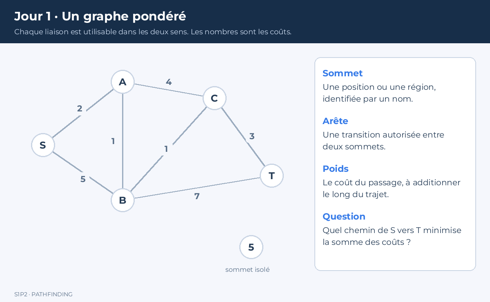
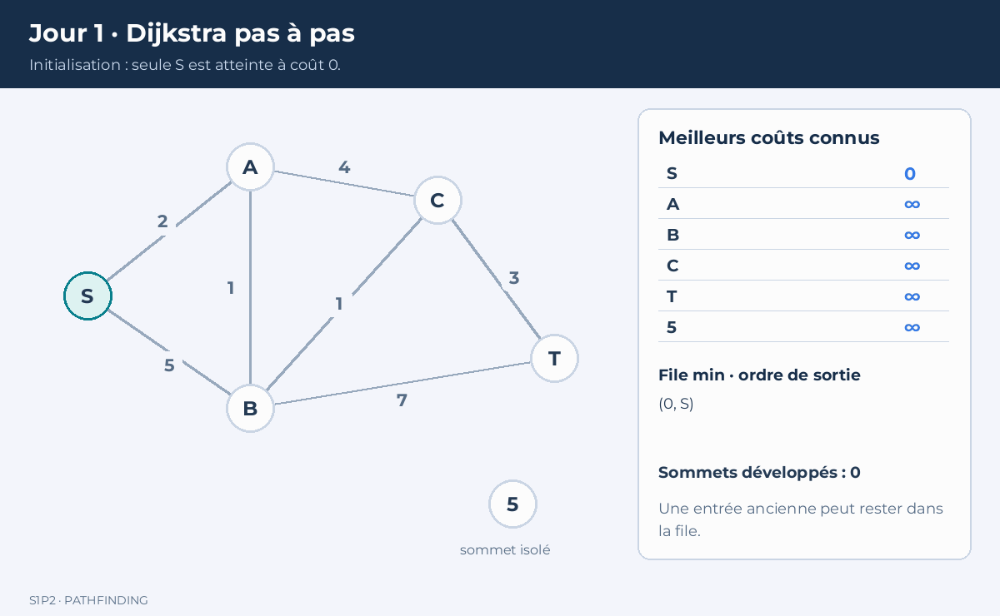

# Jour 1 — Représenter un monde et calculer un plus court chemin

Aujourd’hui, vous allez écrire un calcul de chemin qui fonctionne sans moteur graphique. À partir d’un graphe pondéré, votre programme trouvera un chemin de coût minimal, expliquera son résultat et traitera les situations où aucun chemin n’existe. Cette séparation est volontaire : un algorithme correct doit pouvoir être testé sans ouvrir une fenêtre.

## 1. Comment suivre ce cours

Lisez une section, réalisez l’action demandée, puis vérifiez le résultat avant de continuer. Les corrigés sont regroupés dans des blocs repliables. Essayez d’abord par vous-même. Tous les blocs marqués **fichier complet** peuvent être copiés tels quels. Les autres sont des exemples ou des modifications localisées.

Vous construirez progressivement ce dossier de travail :

```text
pathfinding/
  Graph.hpp
  Search.hpp
  main.cpp
```

Les jours suivants ajouteront des fichiers dans ce même dossier. Conservez un commit à la fin de chaque journée : cela permet de retrouver un état fonctionnel lorsque le fichier `main.cpp` sera remplacé.

**Prérequis :** variables, fonctions, conditions, boucles, tableaux et structures C++. Vous rencontrerez `std::vector`, `std::priority_queue` et les références constantes ; ils sont expliqués lorsqu’ils apparaissent.

### Organisation indicative

1. Préparer l’environnement et vérifier les bases C++
2. Comprendre graphes, poids, BFS et Dijkstra
3. Exécuter Dijkstra sur papier
4. Programmer le graphe, la recherche et la reconstruction
5. Tester les cas limites
6. Expliquer son code et faire le bilan

En binôme, changez de pilote après chaque grande section. Le relecteur doit pouvoir expliquer le code sans que le pilote parle à sa place.

## 2. Préparer la compilation

Utilisez le compilateur C++17 du campus. Les commandes ci-dessous conviennent à GCC ou Clang avec la commande `g++` ou `clang++`. Dans Visual Studio, créez un projet console C++ et activez C++17 ; les fichiers restent identiques. N’installez pas un second compilateur si le poste du campus en possède déjà un.

Dans un terminal ouvert dans `pathfinding`, essayez :

```bash
g++ --version
```

Créez temporairement `main.cpp` :

```cpp
#include <iostream>
int main() {
    std::cout << "Environnement pret\n";
}
```

Compilez puis exécutez :

```bash
g++ -std=c++17 -Wall -Wextra -Wpedantic main.cpp -o cours
./cours
```

Sous Windows avec MinGW, l’exécutable s’appelle généralement `cours.exe` ; dans PowerShell, lancez `./cours.exe`. Si `g++` est introuvable, utilisez le terminal du compilateur installé au campus. Ce problème concerne l’environnement, pas votre algorithme.

Avant de continuer, expliquez pourquoi `main` ne doit être défini qu’une fois par exécutable et pourquoi `#include <vector>` n’est pas la même chose qu’une copie de vos données.

## 3. Du niveau au graphe

Un **graphe** contient des sommets et des arêtes. Un sommet représente une situation possible : une case, un point de passage ou une région du sol. Une arête représente une transition autorisée entre deux sommets.

Un graphe **orienté** autorise des transitions à sens unique. Dans un graphe **non orienté**, chaque liaison est utilisable dans les deux sens. Notre représentation stockera des arêtes orientées ; une liaison non orientée sera donc ajoutée deux fois.

Le **poids** d’une arête mesure son coût : mètres, secondes ou points de déplacement. La somme des poids d’un chemin donne son coût total. Choisissez une unité et conservez-la. Ajouter une distance en mètres à une durée en secondes sans conversion n’a pas de sens.

Un chemin de deux arêtes n’est pas toujours préférable à un chemin de quatre arêtes. Deux grandes traversées de lave peuvent coûter davantage que quatre courts déplacements sur un sol normal.



*Les nombres sur les liaisons sont des coûts, pas un ordre de visite. La même représentation sert à l’exercice de recherche S vers T.*

### Pourquoi une liste d’adjacence

Pour chaque sommet, nous stockons la liste de ses voisins. La mémoire est proportionnelle au nombre de sommets et d’arêtes : **O(V + E)**. Une matrice de toutes les liaisons possibles utiliserait **O(V²)**, même si le niveau contient peu de connexions.

`std::vector<std::vector<Edge>>` signifie ici « une liste de listes d’arêtes ». Le voisinage du sommet `u` est `graph[u]`.

### Fichier complet — `Graph.hpp`

```cpp
#pragma once
#include <cmath>
#include <vector>

struct Edge {
    int to;
    double cost;
};
using Graph = std::vector<std::vector<Edge>>;

inline bool ValidNode(const Graph& graph, int id) {
    return id >= 0 && id < static_cast<int>(graph.size());
}

inline bool ValidGraph(const Graph& graph) {
    for (const auto& neighbors : graph) {
        for (const Edge& edge : neighbors) {
            if (!ValidNode(graph, edge.to) ||
                !std::isfinite(edge.cost) || edge.cost < 0.0) {
                return false;
            }
        }
    }
    return true;
}

inline void AddUndirected(Graph& graph, int a, int b, double cost) {
    // Précondition : a et b sont des indices valides.
    graph.at(a).push_back({b, cost});
    graph.at(b).push_back({a, cost});
}
```

`const Graph&` évite de copier le graphe et interdit sa modification par la fonction. `inline` permet de définir ces petites fonctions dans un en-tête partagé entre plusieurs fichiers sans provoquer de définitions multiples.

La validation refuse les poids négatifs, les infinis, les NaN et les destinations invalides. Une arête de coût zéro est autorisée. `AddUndirected` utilise `at` : un indice invalide provoque une exception plutôt qu’un accès mémoire silencieusement incorrect. Dans l’application finale, validez les données chargées avant de construire le graphe.

## 4. Pourquoi Dijkstra

Une recherche en largeur, ou **BFS**, explore d’abord les chemins utilisant le moins d’arêtes. Elle convient aux déplacements dont toutes les arêtes ont le même coût. Lorsque les coûts diffèrent, nous devons prioriser le **coût cumulé**, pas le nombre d’étapes.

Dijkstra maintient trois informations :

- `distance[v]` : meilleur coût actuellement connu pour atteindre `v` ;
- `parent[v]` : sommet précédent dans ce meilleur chemin ;
- une file de priorité contenant les candidats à explorer.

Au départ, seul le sommet initial a une distance connue : zéro. Les autres distances valent l’infini.

L’opération centrale s’appelle la **relaxation**. Si atteindre `u` coûte 3 et si l’arête `u → v` coûte 2, nous pouvons atteindre `v` pour 5. Si son meilleur coût précédent était 9, nous le remplaçons par 5 et mémorisons `u` comme parent.

```text
nouveau = distance[u] + coût(u, v)
si nouveau < distance[v] :
    distance[v] = nouveau
    parent[v] = u
```

Nous développons toujours le candidat dont le coût connu est minimal. Avec des poids non négatifs, un détour futur ne peut pas rendre ce sommet moins cher une fois qu’il est extrait avec sa distance courante. C’est la propriété qui permet de conclure lorsqu’on **extrait** l’arrivée.

**Ne concluez pas dès que l’arrivée est découverte.** Un autre chemin, encore dans la file, peut l’atteindre à moindre coût.

## 5. Exercice guidé sur papier

Construisez le graphe non orienté suivant :

| Liaison | Coût | Liaison | Coût |
|---|---:|---|---:|
| S–A | 2 | A–C | 4 |
| S–B | 5 | B–C | 1 |
| A–B | 1 | B–T | 7 |
| C–T | 3 | | |

Cherchez un chemin de S à T. Avant de lire le corrigé, écrivez après chaque extraction les distances de A, B, C et T ainsi que leurs parents.

<details>
<summary>Corrigé de la trace</summary>



*La file affichée indique l’ordre de sortie, pas la disposition interne du tas. Orange : extraction courante ; bleu : développés ; turquoise : candidats ; rouge : entrée obsolète ; vert : chemin final. L’arrivée est validée à son extraction. [Voir le résultat en image fixe](illustrations/j1_dijkstra_resultat.png).*

| Sommet extrait | A | B | C | T | Mise à jour notable |
|---|---:|---:|---:|---:|---|
| S | 2 | 5 | ∞ | ∞ | Parents A=S, B=S |
| A | 2 | 3 | 6 | ∞ | Parents B=A, C=A |
| B | 2 | 3 | 4 | 10 | Parents C=B, T=B |
| C | 2 | 3 | 4 | 7 | Parent T=C |
| T | 2 | 3 | 4 | 7 | Arrêt |

Le chemin est S–A–B–C–T et son coût vaut 7. Les valeurs 5 pour B, 6 pour C et 10 pour T ont été remplacées. Si elles sont encore dans la file, elles seront ignorées comme entrées obsolètes.

</details>

## 6. Programmer la recherche

Une file de priorité C++ sort par défaut le plus grand élément. Nous utilisons `std::greater` pour obtenir une **file min**. Les éléments sont des paires `(coût, sommet)` ; la comparaison commence par le coût, puis utilise l’identifiant pour départager les égalités.

Nous ne modifions pas directement une entrée déjà présente dans le tas. Nous insérons une nouvelle paire lorsqu’un coût s’améliore. À l’extraction, nous comparons le coût enregistré avec la meilleure distance actuelle : une ancienne paire plus chère est ignorée.

### Fichier complet — `Search.hpp`

```cpp
#pragma once
#include "Graph.hpp"
#include <algorithm>
#include <chrono>
#include <functional>
#include <limits>
#include <queue>
#include <utility>

// OutsideNavMesh sera utilisé à partir du jour 3.
enum class Status { Found, NoPath, InvalidInput, OutsideNavMesh };

struct SearchResult {
    Status status = Status::InvalidInput;
    std::vector<int> nodes;
    double cost = std::numeric_limits<double>::infinity();
    int expanded = 0;
    double microseconds = 0.0;
};

inline SearchResult Dijkstra(const Graph& graph, int start, int goal) {
    using Clock = std::chrono::steady_clock;
    const auto begin = Clock::now();
    SearchResult result;
    auto finish = [&]() {
        result.microseconds =
            std::chrono::duration<double, std::micro>(Clock::now() - begin).count();
        return result;
    };
    if (!ValidGraph(graph) || !ValidNode(graph, start) ||
        !ValidNode(graph, goal)) return finish();

    const double infinity = std::numeric_limits<double>::infinity();
    std::vector<double> distance(graph.size(), infinity);
    std::vector<int> parent(graph.size(), -1);
    using Entry = std::pair<double, int>;
    std::priority_queue<Entry, std::vector<Entry>, std::greater<Entry>> open;

    distance[start] = 0.0;
    open.push({0.0, start});
    while (!open.empty()) {
        const auto [savedCost, u] = open.top();
        open.pop();
        if (savedCost > distance[u]) continue;
        if (u == goal) {
            result.status = Status::Found;
            result.cost = distance[goal];
            for (int v = goal; v != -1; v = parent[v]) {
                result.nodes.push_back(v);
            }
            std::reverse(result.nodes.begin(), result.nodes.end());
            return finish();
        }
        ++result.expanded;
        for (const Edge& edge : graph[u]) {
            const double candidate = distance[u] + edge.cost;
            if (candidate < distance[edge.to]) {
                distance[edge.to] = candidate;
                parent[edge.to] = u;
                open.push({candidate, edge.to});
            }
        }
    }
    result.status = Status::NoPath;
    return finish();
}
```

`finish` est une fonction locale qui renseigne le temps quelle que soit l’issue. `steady_clock` mesure une durée sans dépendre des changements de l’heure civile.

`expanded` compte les extractions non obsolètes pour lesquelles nous examinons les voisins. L’arrivée n’est donc pas comptée. Ce choix n’est pas universel ; l’essentiel est d’utiliser et d’annoncer la même convention pour les deux algorithmes.

Le coût vaut l’infini en cas d’échec, mais **testez d’abord le statut**. Un chemin vide ne doit jamais être interprété comme une autorisation de traverser un mur.

### Pourquoi la reconstruction fonctionne

Lorsqu’un coût s’améliore, son parent devient le sommet ayant fourni cette amélioration. Partir de l’arrivée puis remonter les parents rejoint donc le départ. Le départ garde le parent `-1`. Le résultat est construit à l’envers, puis retourné.

Nous utilisons une amélioration **stricte**, `<`, et non `<=`. Remplacer un parent pour un coût égal peut notamment créer des problèmes avec des cycles d’arêtes de coût nul.

## 7. Exécuter et vérifier

Remplacez maintenant `main.cpp` par ce **fichier complet** :

```cpp
#include "Search.hpp"
#include <cassert>
#include <cmath>
#include <iostream>

int main() {
    // S=0, A=1, B=2, C=3, T=4 ; sommet 5 isolé.
    Graph graph(6);
    AddUndirected(graph, 0, 1, 2);
    AddUndirected(graph, 0, 2, 5);
    AddUndirected(graph, 1, 2, 1);
    AddUndirected(graph, 1, 3, 4);
    AddUndirected(graph, 2, 3, 1);
    AddUndirected(graph, 2, 4, 7);
    AddUndirected(graph, 3, 4, 3);

    auto r = Dijkstra(graph, 0, 4);
    assert(r.status == Status::Found);
    assert(std::abs(r.cost - 7.0) < 1e-4);
    assert((r.nodes == std::vector<int>{0, 1, 2, 3, 4}));
    assert(Dijkstra(graph, 0, 5).status == Status::NoPath);
    assert(Dijkstra(graph, -1, 4).status == Status::InvalidInput);
    auto same = Dijkstra(graph, 0, 0);
    assert(same.status == Status::Found && same.cost == 0.0);
    assert((same.nodes == std::vector<int>{0}));

    Graph zero(3);
    AddUndirected(zero, 0, 1, 0);
    AddUndirected(zero, 1, 2, 1);
    assert(Dijkstra(zero, 0, 2).cost == 1.0);
    zero[0][0].cost = -1;
    assert(Dijkstra(zero, 0, 2).status == Status::InvalidInput);
    std::cout << "Tests Jour 1 OK\n";
    std::cout << "Cout=" << r.cost << " developpes=" << r.expanded << '\n';
}
```

Compilez avec la commande du début. Vous devez lire `Tests Jour 1 OK` et un coût de 7. Ne compilez pas ces tests avec `-DNDEBUG` : cette option désactive `assert`.

## 8. Travaux pratiques à réaliser sans copier le corrigé

1. Ajoutez une liaison directe S–T de coût 20. Vérifiez que le résultat reste 7.
2. Remplacez ce coût par 1. Vérifiez que le nouveau chemin est direct et coûte 1.
3. Construisez deux itinéraires de même coût. Le test doit accepter deux chemins différents et comparer leur coût.
4. Ajoutez une arête dirigée sans son retour et montrez que le résultat dépend du sens.
5. Pour chaque chemin trouvé, recalculez la somme des arêtes et vérifiez qu’elle correspond à `result.cost`.

<details>
<summary>Indications et résultats attendus</summary>

Pour 1 et 2, utilisez une nouvelle copie du graphe pour chaque scénario. Pour 3, un diamant 0–1–3 et 0–2–3 avec quatre coûts unitaires donne un coût minimal de 2. Pour 4, `graph[0].push_back({1, 1})` ne crée que 0 → 1. Pour 5, parcourez chaque paire de sommets successifs ; dans ce TP, utilisez au plus une arête par paire orientée pour rendre la vérification univoque.

</details>

## 9. Complexité et limites

Avec une liste d’adjacence et un tas binaire, la borne usuelle pour un graphe simple est **O((V + E) log V)**. Notre variante qui conserve les entrées obsolètes peut insérer O(E) entrées ; une écriture plus directe de sa borne est O((V + E) log(V + E)). Le tas peut occuper O(E) mémoire en plus des tableaux O(V).

`ValidGraph` parcourt toutes les arêtes à chaque appel. C’est pratique pour apprendre et sécuriser les tests. Sur un graphe statique de production, on pourra valider une fois à son chargement, à condition de préserver cette garantie. Les mesures de cette semaine incluront cette validation et le préciseront.

Les calculs utilisent des `double`. Des coûts finis extrêmement grands peuvent déborder à la somme : le projet utilise des coûts bornés de taille raisonnable. Une version de production doit aussi définir une politique face au débordement.

## 10. Dépannage et autoévaluation

| Symptôme | Vérification prioritaire |
|---|---|
| Le résultat choisit les routes les plus chères | Le comparateur de la file min |
| Le programme tourne sans fin | L’amélioration stricte et les cycles de coût nul |
| Le chemin ne contient que l’arrivée | La mise à jour des parents |
| Une arrivée isolée provoque un crash | Le statut avant reconstruction |
| Un graphe non orienté fonctionne dans un seul sens | L’ajout de l’arête de retour |

Vous avez terminé si vous pouvez expliquer, sans lire le code : la relaxation, la différence entre découverte et extraction, le rôle des entrées obsolètes, la reconstruction et le refus des poids négatifs.

**À conserver :** les trois fichiers, les tests, votre trace manuelle et un commit `jour-1-dijkstra`. Demain, nous garderons le même problème mais nous guiderons la recherche avec une estimation de la distance restante.
