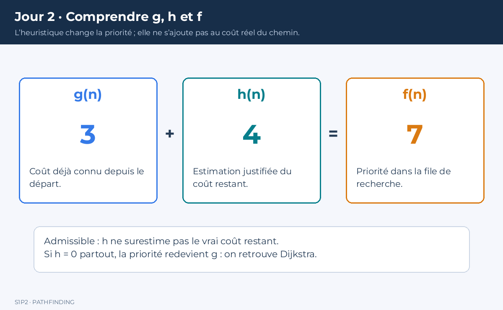
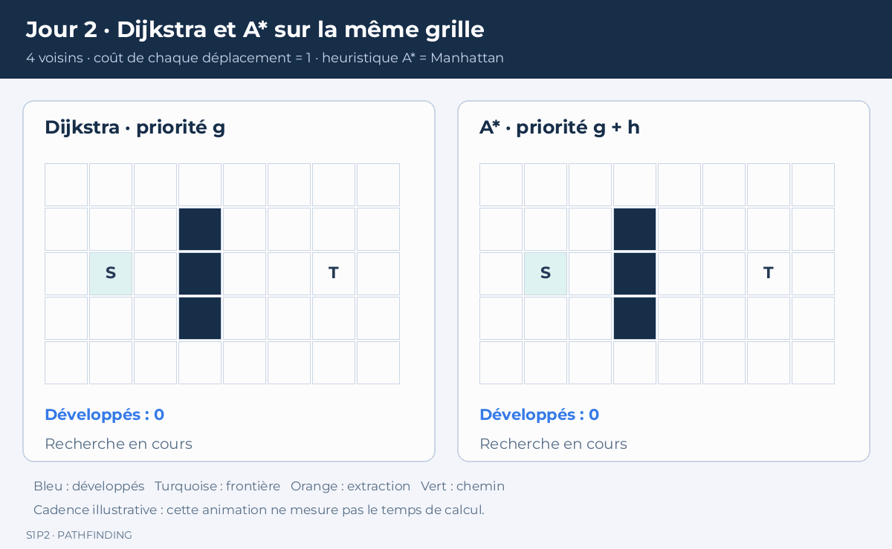

# Guider la recherche avec A étoile

Vous avez calculé un plus court chemin avec Dijkstra. Aujourd’hui, vous allez ajouter une estimation de ce qu’il reste à parcourir. Vous apprendrez surtout à justifier cette estimation : une formule qui « semble marcher » ne suffit pas à garantir un chemin optimal.

## 1. Point de départ et objectif

Reprenez `Graph.hpp`, `Search.hpp` et `main.cpp` du jour 1. Commencez par compiler et lancer les tests. Si un test échoue, corrigez-le avant d’introduire A*.

À la fin de la journée, vous disposerez de deux fonctions, `Dijkstra` et `AStar`, qui travaillent sur le même graphe et retournent la même structure `SearchResult`. Vous saurez comparer leurs résultats sans supposer qu’ils explorent les mêmes sommets.

1. Comprendre g, h, f et les garanties
2. Choisir des heuristiques sur des exemples
3. Programmer A* et construire une grille
4. Tester et mesurer les deux recherches
5. Relire et expliquer les résultats

## 2. Ajouter une estimation

Dijkstra choisit le sommet dont le coût depuis le départ est minimal. Cette stratégie ne tient pas compte de la direction de la destination. Dans un espace ouvert, elle peut explorer beaucoup de positions situées du mauvais côté.

A* utilise trois valeurs :

- **g(n)** : coût du meilleur chemin connu du départ vers n ;
- **h(n)** : estimation du coût restant de n vers l’arrivée ;
- **f(n) = g(n) + h(n)** : priorité dans la file.

`h` ne remplace pas le coût réel. La relaxation continue d’utiliser uniquement les coûts des arêtes pour mettre à jour `g`. L’heuristique sert à choisir le prochain candidat à examiner.

Exemple : deux candidats ont `g(A)=3` et `g(B)=5`. Dijkstra choisit A. Si `h(A)=10` et `h(B)=2`, A* compare 13 et 7 et choisit B.

**Attention :** une faible priorité n’est pas la preuve qu’un chemin a été trouvé. La destination est toujours validée à son extraction dans les conditions de l’algorithme.



*g représente un coût connu, h une estimation du coût restant et f la priorité. L’heuristique ne s’ajoute pas au coût réel enregistré du chemin.*

## 3. Admissibilité et cohérence

### 3.1 Une heuristique admissible ne surestime pas

Notons `h*(n)` le vrai coût minimal restant. Une heuristique admissible vérifie :

```text
0 ≤ h(n) ≤ h*(n)
h(arrivée) = 0
```

Si la vraie distance est 10, estimer 7 est acceptable ; estimer 12 peut amener la recherche à négliger la meilleure route. Une estimation plus informative reste intéressante seulement tant qu’elle respecte les garanties recherchées.

### 3.2 Une heuristique cohérente respecte les transitions

Pour chaque arête `u → v` :

```text
h(u) ≤ coût(u, v) + h(v)
```

Cette condition ressemble à l’inégalité triangulaire. Elle dit que passer par un voisin ne doit pas révéler une estimation brusquement trop optimiste. Avec `h(arrivée)=0`, la cohérence implique l’admissibilité sur les sommets pouvant atteindre l’arrivée.

Avec une heuristique cohérente, on peut implémenter un ensemble fermé sans rouvrir les sommets. Avec une heuristique admissible mais non cohérente, il faut autoriser leur réouverture lorsqu’un meilleur `g` est trouvé. Notre code n’utilise pas d’ensemble fermé définitif : une amélioration peut réinsérer un sommet.

**Cas particulier :** si `h(n)=0` partout, alors `f(n)=g(n)` et A* devient Dijkstra.

### 3.3 Le choix dépend du déplacement autorisé

| Graphe de déplacement | Coût des mouvements | Heuristique adaptée |
|---|---|---|
| Grille à 4 voisins | 1 par pas | Manhattan : `abs(dx) + abs(dy)` |
| Grille à 8 voisins | 1 en ligne, √2 en diagonale | Octile : `max(dx,dy) + (√2−1) min(dx,dy)` |
| Positions dans le plan | Coût d’une arête ≥ sa longueur | Distance euclidienne |
| Terrain pondéré | Longueur × coût au mètre | Distance × coût minimal au mètre |
| Coûts sans borne géométrique connue | Arbitraires et non négatifs | Zéro, jusqu’à justification plus précise |

Un téléporteur de coût 1 entre deux points distants de 100 mètres invalide la distance euclidienne comme minorant du coût. Le dessin du niveau ne suffit pas : ce sont les transitions et leurs coûts qui déterminent l’heuristique.

## 4. Exercice avant programmation

Du point (0,0) au point (3,4), calculez Manhattan, Euclide et octile. Puis répondez : Manhattan reste-t-elle admissible si les diagonales coûtent √2 ?

<details>
<summary>Corrigé</summary>

Manhattan vaut 7. Euclide vaut 5. Octile vaut `3√2 + 1`, environ 5,243. Avec trois pas diagonaux puis un pas droit, on atteint l’arrivée pour 5,243 : Manhattan surestime donc cette grille à huit voisins. Euclide est admissible dans les deux grilles considérées, mais moins informative que Manhattan pour les quatre voisins et que l’octile pour les huit voisins en espace libre.

</details>

Sur papier, reprenez ensuite le graphe du jour 1. Utilisez les valeurs `h(S)=7`, `h(A)=5`, `h(B)=4`, `h(C)=3`, `h(T)=0`. Vérifiez la cohérence dans les deux sens de chaque liaison, puis faites une trace de A*.

<details>
<summary>Vérification et trace attendues</summary>

Ces valeurs sont les vrais coûts restants de ce petit graphe. Pour S–A, `7 ≤ 2+5` et `5 ≤ 2+7`. Faites de même pour les autres liaisons. L’ordre utile est S, A, B, C, T. Après S, A a la priorité 7 et B la priorité 9 ; le passage par A améliore B à `g=3`, donc `f=7`. Le coût final reste 7. Sur ce petit exemple, le gain de sommets explorés est faible : une heuristique correcte ne garantit pas un gain spectaculaire sur tous les graphes.

</details>

## 5. Une implémentation partagée

Pour éviter que deux versions divergent, nous allons partager relaxation, reconstruction, validation et métriques. La seule différence sera la fonction `h`.

**Remplacez entièrement `Search.hpp` par le fichier complet suivant.** Ne conservez pas l’ancienne définition de `Dijkstra` dans le même fichier.

```cpp
#pragma once
#include "Graph.hpp"
#include <algorithm>
#include <chrono>
#include <functional>
#include <limits>
#include <queue>
#include <tuple>

// Ce fichier remplace la version du jour 1.
enum class Status { Found, NoPath, InvalidInput, OutsideNavMesh };
struct SearchResult {
    Status status = Status::InvalidInput;
    std::vector<int> nodes;
    double cost = std::numeric_limits<double>::infinity();
    int expanded = 0;
    double microseconds = 0.0;
};
using Heuristic = std::function<double(int)>;

inline SearchResult Search(const Graph& graph, int start, int goal,
                           const Heuristic& heuristic) {
    using Clock = std::chrono::steady_clock;
    const auto begin = Clock::now();
    SearchResult result;
    auto finish = [&]() {
        result.microseconds =
            std::chrono::duration<double, std::micro>(Clock::now() - begin).count();
        return result;
    };
    if (!ValidGraph(graph) || !ValidNode(graph, start) ||
        !ValidNode(graph, goal) || !heuristic) return finish();

    // Pré-calcul pratique pour valider les valeurs et ne pas les recalculer.
    // La cohérence ou l'admissibilité reste à justifier séparément.
    std::vector<double> h(graph.size());
    for (int i = 0; i < static_cast<int>(graph.size()); ++i) {
        h[i] = heuristic(i);
        if (!std::isfinite(h[i]) || h[i] < 0.0) return finish();
    }
    if (std::abs(h[goal]) > 1e-9) return finish();

    const double infinity = std::numeric_limits<double>::infinity();
    std::vector<double> g(graph.size(), infinity);
    std::vector<int> parent(graph.size(), -1);
    // Ordre de comparaison : f, puis g, puis identifiant.
    using Entry = std::tuple<double, double, int>;
    std::priority_queue<Entry, std::vector<Entry>, std::greater<Entry>> open;
    g[start] = 0.0;
    open.push({h[start], 0.0, start});
    while (!open.empty()) {
        const auto [priority, savedG, u] = open.top();
        open.pop();
        (void)priority;
        if (savedG > g[u]) continue;
        if (u == goal) {
            result.status = Status::Found;
            result.cost = g[goal];
            for (int v = goal; v != -1; v = parent[v]) result.nodes.push_back(v);
            std::reverse(result.nodes.begin(), result.nodes.end());
            return finish();
        }
        ++result.expanded;
        for (const Edge& edge : graph[u]) {
            const double candidate = g[u] + edge.cost;
            if (candidate < g[edge.to]) {
                g[edge.to] = candidate;
                parent[edge.to] = u;
                open.push({candidate + h[edge.to], candidate, edge.to});
            }
        }
    }
    result.status = Status::NoPath;
    return finish();
}

inline SearchResult Dijkstra(const Graph& graph, int start, int goal) {
    return Search(graph, start, goal, [](int) { return 0.0; });
}
inline SearchResult AStar(const Graph& graph, int start, int goal,
                          const Heuristic& heuristic) {
    return Search(graph, start, goal, heuristic);
}
```

La fonction anonyme `[](int) { return 0.0; }` est une **lambda**. Elle se comporte comme une petite fonction passée en paramètre. Dans les exemples suivants, une lambda capturera les coordonnées de l’arrivée.

Relancez les tests du jour 1 : ils doivent fonctionner sans modification. Vous venez de faire un **refactoring** : modifier l’organisation interne en conservant le comportement testé.

### Lire le code avec précision

Le fait de vérifier des valeurs finies, positives et nulles à l’arrivée ne prouve pas qu’une heuristique est admissible. Une heuristique de 1000 partout sauf à l’arrivée passe une partie de cette validation, mais peut rester incorrecte. Il faut une démonstration ou des contrôles supplémentaires sur vos graphes.

Le pré-calcul de `h` coûte O(V) à chaque recherche, y compris pour Dijkstra. Pour nos petits niveaux, il simplifie l’explication et permet une comparaison équitable. N’interprétez pas les chronométrages comme ceux d’une bibliothèque optimisée.

## 6. Construire une grille de test

Une grille sert aujourd’hui à produire facilement un graphe plus grand. **Elle ne remplacera pas le NavMesh polygonal demandé au projet.**

Numérotation : pour la case `(x,y)` d’une grille de largeur W, utilisez `id = y*W+x`. Pour retrouver les coordonnées : `x=id%W`, `y=id/W`.

Remplacez `main.cpp` par ce **fichier complet** :

```cpp
#include "Search.hpp"
#include <cassert>
#include <cmath>
#include <iostream>
#include <string>

int main() {
    const std::vector<std::string> map = {
        "........",
        "...#....",
        "...#....",
        "...#....",
        "........"
    };
    const int width = 8, height = 5;
    auto id = [=](int x, int y) { return y * width + x; };
    auto walkable = [&](int x, int y) {
        return x >= 0 && x < width && y >= 0 && y < height && map[y][x] != '#';
    };
    Graph graph(width * height);
    const int dx[4] = {1, -1, 0, 0};
    const int dy[4] = {0, 0, 1, -1};
    for (int y = 0; y < height; ++y) {
        for (int x = 0; x < width; ++x) {
            if (!walkable(x, y)) continue;
            for (int k = 0; k < 4; ++k) {
                int nx = x + dx[k], ny = y + dy[k];
                if (walkable(nx, ny)) graph[id(x, y)].push_back({id(nx, ny), 1.0});
            }
        }
    }
    const int start = id(1, 2), goal = id(6, 2);
    auto h = [&](int n) -> double {
        return std::abs(n % width - goal % width) +
               std::abs(n / width - goal / width);
    };
    const auto d = Dijkstra(graph, start, goal);
    const auto a = AStar(graph, start, goal, h);
    assert(d.status == Status::Found && a.status == Status::Found);
    assert(std::abs(d.cost - a.cost) < 1e-4);
    assert(std::abs(a.cost - 9.0) < 1e-4);
    const auto zero = AStar(graph, start, goal, [](int) { return 0.0; });
    assert(std::abs(zero.cost - d.cost) < 1e-4);
    for (int u = 0; u < static_cast<int>(graph.size()); ++u) {
        for (const auto& e : graph[u]) assert(h(u) <= e.cost + h(e.to) + 1e-9);
    }
    std::cout << "Tests Jour 2 OK\n";
    std::cout << "Dijkstra cout=" << d.cost << " developpes=" << d.expanded << '\n';
    std::cout << "A* cout=" << a.cost << " developpes=" << a.expanded << '\n';
}
```

Compilez comme hier. Le coût attendu est 9 : il faut contourner la colonne de murs par la ligne du haut ou celle du bas. Les sommets correspondant aux murs existent dans le tableau mais n’ont aucune arête ; les entrées utilisateur devront plus tard interdire de les sélectionner comme départ.



*Cette animation utilise la grille, les coûts et le départ/arrivée du programme ci-dessus. Avec les mêmes départages de priorité, Dijkstra développe 34 sommets et A* 29 ; l’arrivée n’est pas comptée. La cadence est choisie pour la lecture : ce n’est pas une mesure de vitesse. Les couleurs distinguent frontière, développés, extraction et chemin final. [Voir la comparaison finale en image fixe](illustrations/j2_comparaison_resultat.png).*

## 7. Mesurer sans se tromper de conclusion

Le coût, le nombre de sommets développés et le temps répondent à trois questions différentes :

1. Le chemin minimise-t-il la fonction de coût annoncée ?
2. Combien de travail de parcours du graphe a été réalisé ?
3. Combien de temps l’implémentation a-t-elle réellement pris ?

A* peut développer moins de sommets tout en étant plus lent sur un petit graphe, à cause du calcul de `h` ou du bruit de mesure. Il peut aussi être peu efficace face à certains obstacles. N’écrivez pas « A* est toujours plus rapide ».

### Protocole de TP

- Fixez dix couples départ/arrivée valides ; conservez-les dans le code ou dans des données.
- Ajoutez un cas inaccessible en construisant une barrière complète.
- Exécutez chaque recherche cent fois par couple, sans affichage dans la partie mesurée.
- Compilez les mesures avec `-O2`. Gardez une exécution de tests séparée sans `-DNDEBUG`.
- Pour les statuts `Found`, comparez les coûts à `1e-4`. Pour les autres, comparez les statuts, pas `infini - infini`.
- Triez les durées. Pour N valeurs, prenez comme p95 l’élément d’indice `ceil(0.95*N)-1`. Annoncez votre convention de médiane ; pour N pair, moyenne des deux valeurs centrales.

Tableau à remplir :

| Scène | Requête | Algorithme | Statut | Coût | Développés | Médiane µs | p95 µs |
|---|---|---|---|---:|---:|---:|---:|
| Grille avec mur | 1 | Dijkstra | | | | | |
| Grille avec mur | 1 | A* | | | | | |

## 8. Exercices d’approfondissement

**Exercice A — Huit voisins.** Ajoutez les diagonales de coût √2, puis utilisez l’octile. Si une diagonale va de `(x,y)` à `(x+1,y+1)`, exigez que les deux cases `(x+1,y)` et `(x,y+1)` soient aussi libres pour éviter de couper un coin fermé.

**Exercice B — Terrain lent.** Attribuez aux arêtes entrant dans une case boueuse un coût 4 au lieu de 1. Manhattan reste admissible si tous les pas coûtent au moins 1. Le graphe peut devenir orienté car entrer dans la boue et en sortir n’ont pas le même coût.

**Exercice C — Heuristique trop forte.** Remplacez h par `2*h`, notez les coûts obtenus et cherchez un contre-exemple. Le fait que dix requêtes donnent le bon résultat ne démontre pas la garantie.

<details>
<summary>Contre-exemple explicite à une heuristique inadmissible</summary>

Graphe dirigé : S→A coûte 2, A→T coûte 2, S→B coûte 1, B→T coûte 10. Le meilleur chemin coûte 4 via A. Si h(A)=100 et h(B)=0, après S les priorités valent 102 pour A et 1 pour B. B découvre T à 11, puis T est extrait avant A : résultat 11. h(A) surestime le vrai coût restant 2.

</details>

## 9. Erreurs fréquentes et validation finale

| Erreur | Conséquence |
|---|---|
| Ajouter h au coût enregistré dans g | Le coût annoncé n’est plus le coût du chemin |
| Utiliser Manhattan avec des diagonales bon marché | Perte de la garantie d’optimalité |
| Fermer définitivement avec une heuristique non cohérente | Des améliorations peuvent être ignorées |
| Comparer uniquement les chemins exacts | Faux échec si plusieurs chemins optimaux existent |
| Chronométrer la console ou le rendu | Mesure de l’affichage plutôt que de la recherche |

Vous avez terminé lorsque les tests des jours 1 et 2 passent, que vous avez un tableau de résultats et que chaque membre peut expliquer pourquoi son heuristique convient à son graphe.

**À conserver :** `Search.hpp` remplacé, les deux versions de `main.cpp` dans l’historique Git, la grille et les mesures. Faites un commit `jour-2-astar`. Demain, les sommets ne seront plus des cases mais des régions convexes du sol.
