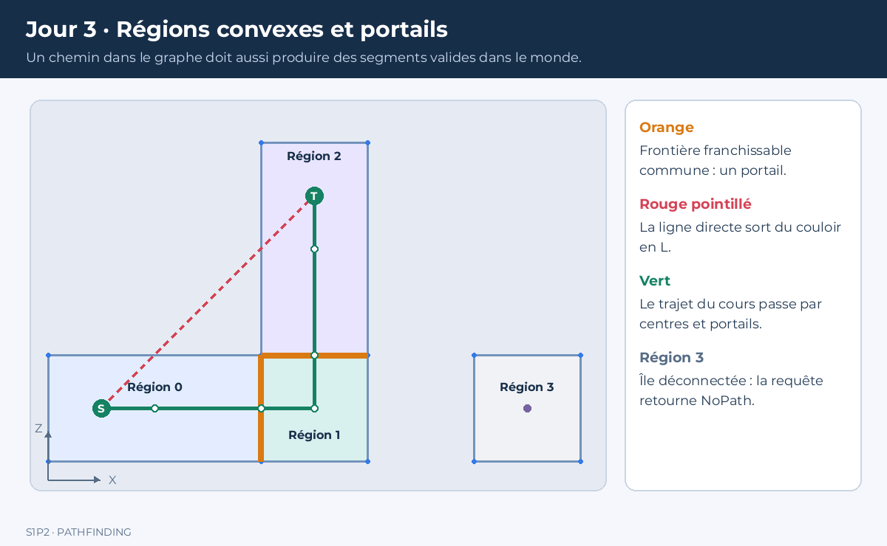
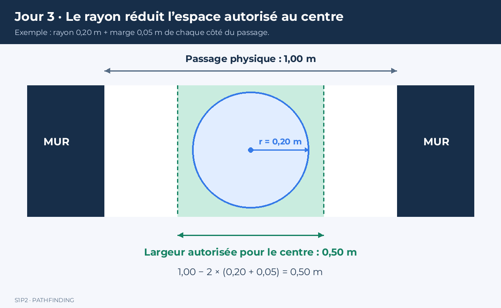

# Atelier : construire et éprouver un NavMesh


Un chemin peut être correct dans un graphe et traverser un mur à l’écran. Aujourd’hui, vous allez construire le lien entre les surfaces du niveau, leurs connexions et le trajet suivi par un personnage.

Ce cours est un atelier en binôme. À chaque étape, produisez un résultat, vérifiez-le et expliquez-le avant de continuer. Alternez les rôles : une personne programme, l’autre prépare les tests et relit. Inversez les rôles à l’étape suivante.

## 1. Mission et fichiers de départ

Vous devez livrer un petit NavMesh manuel et statique pour un sol horizontal, capable de localiser un point, chercher une suite de régions et produire des points de passage valides.

Reprenez `Graph.hpp` et `Search.hpp` du jour 2, avec les tests fonctionnels. Créez `NavMesh.hpp` et un nouveau `main.cpp`. Conservez les anciens programmes dans Git.

Le plan utilise les coordonnées **X et Z**. Y sera la hauteur dans le rendu 3D. Nous ne traitons pas aujourd’hui les étages superposés, les sauts, les obstacles mobiles ni la génération automatique depuis une scène 3D.

Les connexions seront d’abord déclarées manuellement. La détection automatique d’arêtes communes est un approfondissement, pas un préalable pour réussir l’atelier.

### Livrables

- Un plan découpé en régions convexes et un graphe annoté.
- `NavMesh.hpp` complété et un programme de tests.
- Un tableau indiquant les entrées, statuts et résultats attendus.
- Une seconde petite carte personnelle.
- Une fiche de diagnostic expliquant un échec rencontré et sa correction.

Ne passez pas directement au code : les deux premières étapes servent à définir les données qu’il devra représenter.

## 2. Atelier papier — Découper une salle

Dessinez une salle rectangulaire de 12 m sur 8 m. Placez un obstacle central rectangulaire entre X=5 et X=7, Z=2 et Z=6. Ajoutez, à droite, un couloir entre X=12 et X=16, Z=3 et Z=5. Dessinez enfin une petite zone séparée, sans connexion à la salle.

1. Coloriez le sol praticable, sans remplir l’obstacle.
2. Découpez ce sol en régions convexes.
3. Numérotez les régions et donnez leurs sommets dans l’ordre autour du contour.
4. Marquez chaque frontière franchissable entre deux régions.
5. Placez un départ à gauche de l’obstacle et une arrivée dans le couloir.
6. Échangez le dessin avec un autre binôme et cherchez une erreur dans leur proposition.

Un polygone est **convexe** si le segment entre deux points quelconques de ce polygone reste entièrement à l’intérieur ou sur sa frontière. Essayez plusieurs segments ; un seul segment sortant suffit à démontrer qu’une région n’est pas convexe. Quelques essais réussis ne constituent pas une preuve générale.

### Questions à résoudre

- Pourquoi la salle entière, obstacle compris comme trou, ne peut-elle pas être une unique région convexe ?
- Un obstacle doit-il devenir un sommet du graphe ou une absence de surface ?
- Deux régions qui se touchent par un coin permettent-elles un passage de largeur positive ?
- Existe-t-il plusieurs découpages corrects du même niveau ?

**Validation :** aucun intérieur de région ne recouvre un obstacle ; les régions ne se recouvrent pas entre elles ; chaque région est convexe ; les connexions représentent de vrais passages. Plusieurs découpages peuvent être valides.

<details>
<summary>Indice : comment commencer le découpage ?</summary>

Prolongez certains côtés de l’obstacle jusqu’aux limites de la salle pour obtenir des rectangles. Le couloir devient une région supplémentaire. Si vous voulez détecter automatiquement les portails par égalité d’arêtes complètes, découpez aussi les grands bords lorsque plusieurs petites régions les rejoignent. Pour les connexions manuelles de cet atelier, un portail peut être un sous-segment commun de deux bords.

</details>

## 3. Du dessin au graphe

Un sommet du graphe représente une région. Une arête représente un passage entre deux régions. Ce passage possède une géométrie : un segment appelé **portail**.

Choisissez un point intérieur de référence pour chaque région, nommé `center`. Pour nos polygones convexes, la moyenne des sommets convient. Elle n’est pas forcément le centre de masse exact.

Pour un portail de milieu M entre A et B, utilisez :

```text
coût(A,B) = distance(centerA,M) + distance(M,centerB)
```

Vous modélisez ainsi un déplacement qui passe par les centres et les milieux des portails. Ce modèle n’est pas le plus court chemin géométrique parmi tous les trajets sur le sol.

Sur votre dessin, construisez le graphe et tracez deux itinéraires possibles autour de l’obstacle. Calculez leurs coûts selon cette règle. Le trajet avec le moins de régions est-il nécessairement le moins coûteux ? Justifiez votre réponse.

### Carte commune pour programmer

Tous les binômes utilisent d’abord ce petit exemple, pour comparer leurs résultats :

| Région | Étendue du rectangle | Centre | Voisins |
|---|---|---|---|
| 0 | X de 0 à 4, Z de 0 à 2 | (2,1) | 1 |
| 1 | X de 4 à 6, Z de 0 à 2 | (5,1) | 0, 2 |
| 2 | X de 4 à 6, Z de 2 à 6 | (5,4) | 1 |
| 3 | X de 8 à 10, Z de 0 à 2 | (9,1) | Aucun |

Les régions 0, 1 et 2 forment un L. La région 3 est déconnectée.



*Le trajet vert passe par les centres et les milieux des portails. Le segment rouge traverse une zone non navigable.*

Avant de programmer, calculez : le milieu de chaque portail, les deux coûts d’arête, la suite de régions entre `(1,1)` et `(5,5)`. Faites vérifier ces résultats par un autre binôme.

## 4. Préparer les types — Socle fourni

Copiez uniquement ce socle dans `NavMesh.hpp`. Il contient les opérations mathématiques et les structures, pas les solutions des étapes suivantes.

```cpp
#pragma once
#include "Search.hpp"
#include <cmath>
#include <stdexcept>

struct Point {
    double x = 0.0, z = 0.0;
};
inline Point operator+(Point a, Point b) { return {a.x+b.x,a.z+b.z}; }
inline Point operator-(Point a, Point b) { return {a.x-b.x,a.z-b.z}; }
inline Point operator*(Point a, double s) { return {a.x*s,a.z*s}; }
inline double Cross(Point a, Point b) { return a.x*b.z-a.z*b.x; }
inline double Length(Point a) { return std::hypot(a.x,a.z); }
inline double Distance(Point a, Point b) { return Length(a-b); }
inline bool Finite(Point p) { return std::isfinite(p.x)&&std::isfinite(p.z); }
inline bool SamePoint(Point a, Point b) { return Distance(a,b)<1e-8; }

struct Polygon {
    std::vector<Point> vertices;
    Point center;
};
struct Portal {
    int a, b;
    Point left, right;
    Point Middle() const { return (left+right)*0.5; }
};

// À définir après les structures : étape 5.
inline Polygon MakePolygon(std::vector<Point> vertices);
inline bool Contains(const Polygon& polygon, Point point);

struct NavMesh {
    std::vector<Polygon> polygons;
    std::vector<Portal> portals;
    Graph graph;

    int Locate(Point p) const;                 // Étape 5
    const Portal* Between(int a,int b) const;  // Étape 6
    void BuildGraph();                        // Étape 6
};

struct NavPath {
    SearchResult search;
    std::vector<Point> points;
    double routeCost=std::numeric_limits<double>::infinity();
};

inline NavMesh MakeDemoMesh();                 // Étape 6
inline NavPath FindNavPath(const NavMesh& mesh, Point start,
                          Point goal, bool useAStar=true); // Étape 7
```

Les déclarations annoncent des fonctions qu’il reste à définir. Un appel sans définition provoquera une erreur de liaison : c’est normal tant que l’étape correspondante n’est pas terminée. Définissez les fonctions libres avec `inline`, puisqu’elles se trouvent dans un en-tête. Pour les méthodes définies en dehors de la structure, écrivez par exemple `inline int NavMesh::Locate(Point p) const`.

`left` et `right` sont ici seulement les noms des extrémités stockées. Ils ne fournissent pas encore une orientation permettant d’utiliser directement un algorithme funnel.

## 5. Programmer la localisation d’un point

### 5.1 Préparer un polygone

Implémentez `MakePolygon` : elle reçoit les sommets et renvoie le polygone avec la moyenne des sommets dans `center`.

Pour cette première version, exigez au moins trois sommets, tous finis, sans répétition. Le respect de la convexité et de l’ordre des sommets est une **précondition contrôlée sur le dessin**. Ne prétendez pas que ces seuls tests valident un polygone arbitraire. Le rejet automatique des polygones concaves viendra en approfondissement.

Utilisez `throw std::invalid_argument("message")` pour les données rejetées. N’ajoutez pas une copie du premier sommet à la fin du tableau : la fermeture se fait avec l’indice modulo.

### 5.2 Comprendre le produit vectoriel

Pour un bord A→B et un point P, calculez :

```cpp
const double side = Cross(B-A, P-A);
```

Le signe indique de quel côté du bord se trouve P. Testez sur papier A=(0,0), B=(4,0), puis P=(2,1), P=(2,-1) et P=(2,0). Vous devez obtenir respectivement un signe positif, négatif et nul.

Dans un polygone convexe dont les sommets sont ordonnés, un point intérieur se trouve du même côté de tous les bords. Si vous rencontrez à la fois un signe nettement positif et un signe nettement négatif, le point est extérieur.

### 5.3 Implémenter `Contains`

Contraintes :

- Refuser un point non fini.
- Parcourir tous les bords, y compris le dernier vers le premier.
- Utiliser une tolérance `1e-8` autour de zéro.
- Accepter les points sur la frontière.
- Accepter les deux sens d’ordre des sommets.

Préparez les tests **avant** le code : intérieur, extérieur, bord, sommet, puis mêmes cas avec les sommets inversés.

<details>
<summary>Indice 1</summary>

Conservez deux booléens : avez-vous déjà vu un produit supérieur à la tolérance ? Avez-vous déjà vu un produit inférieur à l’opposé de la tolérance ? Si les deux deviennent vrais, retournez `false`.

</details>

<details>
<summary>Indice 2</summary>

Le bord d’indice i relie `vertices[i]` à `vertices[(i+1)%vertices.size()]`. Ne rejetez pas un point uniquement parce qu’un produit est nul : il peut appartenir au bord.

</details>

### 5.4 Implémenter `Locate`

Parcourez les polygones, retournez l’indice du premier qui contient le point ; retournez -1 si aucun ne convient. Refusez également les points non finis.

Sur une frontière commune, le choix du premier polygone constitue notre convention déterministe. Cela suppose des connexions correctement déclarées ; dans un système plus complet, on pourra conserver la région courante.

**Point de contrôle :** sur la carte commune, `(1,1)` appartient à 0, `(5,5)` à 2, `(3,3)` est extérieur et `(9,1)` appartient à l’île 3. Un point sur l’île est localisable même si aucun chemin depuis le départ ne l’atteint.

## 6. Déclarer les portails et construire le graphe

Dans `MakeDemoMesh`, construisez les quatre rectangles avec `MakePolygon`, en ordonnant leurs sommets autour du contour.

Déclarez manuellement les deux portails :

| Régions | Extrémité 1 | Extrémité 2 |
|---|---|---|
| 0 et 1 | (4,0) | (4,2) |
| 1 et 2 | (4,2) | (6,2) |

Appelez ensuite `BuildGraph` et retournez le maillage.

### Contrat de `BuildGraph`

Cette version **lit les portails existants**. Elle ne les efface pas et ne les recherche pas automatiquement.

1. Réinitialisez `graph` avec une liste vide par polygone.
2. Vérifiez pour chaque portail que les deux indices sont valides et différents.
3. Refusez une longueur de portail nulle.
4. Vérifiez que les deux extrémités appartiennent aux deux régions.
5. Calculez le milieu, puis le coût défini à l’étape 3.
6. Ajoutez les deux sens avec `AddUndirected`.

Les régions manuelles sont supposées convexes, sans recouvrement de leurs intérieurs. Dans ce cadre, un segment non nul appartenant aux deux régions est une frontière commune. Un validateur général devrait aussi vérifier les recouvrements et la géométrie de l’ensemble.

`Between(a,b)` doit retrouver un portail dans les deux sens et retourner un pointeur vers lui, ou `nullptr` en son absence. N’utilisez ce pointeur que tant que le tableau des portails n’est pas modifié.

**Tests :** deux portails, coût 3 pour 0↔1, coût 3 pour 1↔2, aucune sortie depuis 3. Appelez `BuildGraph` deux fois : cela ne doit pas doubler les arêtes.

## 7. Assembler la requête de navigation

Implémentez `FindNavPath` en suivant ce contrat, sans ajouter de projection automatique sur le sol.

### 7.1 Valider et localiser

- Coordonnée non finie : conserver `InvalidInput`.
- Départ ou arrivée hors de toutes les régions : retourner `OutsideNavMesh`.
- Points localisés dans des régions déconnectées : laisser la recherche produire `NoPath`.

Un point extérieur et un point accessible géométriquement mais déconnecté ne sont pas la même erreur.

### 7.2 Chercher une suite de régions

Appelez Dijkstra ou A* suivant `useAStar`. Pour A*, prenez la distance entre le centre du sommet courant et le centre de la région d’arrivée.

Justifiez cette heuristique : le coût de chaque connexion, via le portail, est au moins la distance directe entre les deux centres. L’inégalité triangulaire permet d’établir sa cohérence. L’heuristique doit viser le **centre de la région d’arrivée**, afin d’être nulle au sommet but de ce graphe.

Si le statut n’est pas `Found`, ne construisez pas de points de passage.

### 7.3 Construire les points

Pour deux régions différentes, ajoutez dans cet ordre :

1. Le départ.
2. Le centre de sa région.
3. Pour chaque transition : le milieu du portail puis le centre de la région suivante.
4. L’arrivée.

Si les deux points sont dans la même région, utilisez simplement le segment départ–arrivée. Évitez les doublons consécutifs avec `SamePoint`. Si un portail annoncé par le graphe est introuvable, retournez un résultat vide `InvalidInput`.

Enfin, calculez `routeCost` en additionnant les distances entre points successifs. Ne remplacez pas `search.cost` : il mesure le coût du graphe.

<details>
<summary>Indice : éviter les doublons</summary>

Créez une petite lambda `append` qui ajoute un point seulement si le tableau est vide ou si le dernier point est différent. Cela permet au trajet départ=arrivée de contenir un seul point.

</details>

### Résultats de référence

Entre `(1,1)` et `(5,5)` : régions `0,1,2`, coût du graphe 6, longueur totale 8. Les sept points sont :

```text
(1,1), (2,1), (4,1), (5,1), (5,2), (5,4), (5,5)
```

Expliquez à votre partenaire d’où viennent les deux unités supplémentaires. Pour cette requête entre régions différentes, les connexions du départ et de l’arrivée aux centres ajoutent chacune une unité.

## 8. Construire le programme de tests

Écrivez votre `main.cpp` en partant de cette trame. Complétez les autres cas du tableau ; la trame seule ne valide pas l’atelier.

```cpp
#include "NavMesh.hpp"
#include <cassert>
#include <iostream>

int main() {
    const NavMesh mesh=MakeDemoMesh();
    assert(mesh.portals.size()==2);
    assert(mesh.Locate({1,1})==0);
    assert(mesh.Locate({3,3})==-1);

    const auto a=FindNavPath(mesh,{1,1},{5,5},true);
    const auto d=FindNavPath(mesh,{1,1},{5,5},false);
    assert(a.search.status==Status::Found);
    assert(d.search.status==Status::Found);
    assert(std::abs(a.search.cost-d.search.cost)<1e-4);
    assert(std::abs(a.search.cost-6.0)<1e-4);
    assert(std::abs(a.routeCost-8.0)<1e-4);

    // TODO : frontières, île, extérieur, même région,
    // départ=arrivée, sommets inversés, portail invalide.
    std::cout << "Tests ecrits jusqu'ici : OK\n";
}
```

| Cas à tester | Résultat attendu |
|---|---|
| Départ (1,1), arrivée (9,1) | `NoPath` |
| Départ (1,1), arrivée (3,3) | `OutsideNavMesh` |
| Départ extérieur, arrivée intérieure | `OutsideNavMesh` |
| Départ et arrivée (1,1) | `Found`, longueur 0, un point |
| Départ (1,1), arrivée (3,1) | `Found`, trajet direct de longueur 2 |
| Point (4,1), frontière entre 0 et 1 | `Locate` choisit 0 dans notre ordre |
| Sommets d’un rectangle inversés | Même résultat pour `Contains` |
| Portail de longueur nulle | Rejet par `BuildGraph` |
| Portail vers un indice inexistant | Rejet par `BuildGraph` |

Pour tester une exception attendue, utilisez `try/catch` et vérifiez qu’elle a bien été déclenchée. Ne laissez pas une exception prévue arrêter toute la suite de tests.


## 9. Enquête — Pourquoi le segment direct échoue-t-il ?

Tracez le segment entre `(1,1)` et `(5,5)`. À son milieu, il passe par `(3,3)`, qui est hors de la surface. Le fait que ses extrémités soient localisables ne suffit donc pas à valider le déplacement.

Écrivez un diagnostic qui échantillonne chaque segment du trajet calculé et vérifie que ses points sont localisables. Introduisez volontairement le segment direct pour voir le test échouer.

**Attention :** un échantillonnage peut manquer une petite sortie entre deux échantillons. Ce n’est pas une preuve géométrique universelle. La validité de notre construction repose sur la convexité : chaque segment centre–portail reste dans une région, et chaque transition passe par une frontière commune valide.

Dans votre fiche de diagnostic, distinguez :

- une arête de graphe incorrecte ;
- une erreur de points de passage ;
- une erreur de localisation ;
- un niveau qui ne respecte pas les préconditions géométriques.

Faites exprès de supprimer un portail tout en conservant son arête de graphe. Votre requête doit signaler l’incohérence, pas dereférencer un pointeur nul.

## 10. Un agent possède un rayon

Le centre d’un personnage peut rester sur le sol alors que son corps traverse un mur. Le NavMesh destiné à un rayon fixé doit représenter les positions autorisées du **centre**, en tenant compte de ce rayon.



*Passage physique de 1 m, rayon de 0,20 m et marge de 0,05 m par côté : la bande autorisée au centre mesure 0,50 m.*

Calculez la largeur restante pour ces trois passages :

| Largeur physique | Rayon | Marge par côté | Largeur autorisée au centre |
|---:|---:|---:|---|
| 1,00 m | 0,20 m | 0,05 m | À calculer |
| 0,45 m | 0,20 m | 0,05 m | À calculer |
| 0,50 m | 0,20 m | 0,05 m | À calculer |

Utilisez `largeur − 2 × (rayon + marge)`. Une largeur négative rend le passage impossible pour ce modèle ; une largeur nulle ne fournit aucune bande de largeur positive et sera refusée dans cet atelier.

Sur votre plan, dessinez une limite physique de mur et la limite autorisée au centre. N’essayez pas aujourd’hui de programmer une réduction générale de polygones : l’objectif est de comprendre et vérifier la contrainte sur des passages simples.

**Ne comptez pas deux fois le rayon.** Si les régions ont déjà été réduites pour l’agent, ne réduisez pas encore les portails de la même quantité. La carte en L est une surface abstraite destinée au centre, pas un plan de murs physiques déjà fourni.

## 11. Construire votre seconde carte

Créez `MakePersonalMesh` sans modifier Dijkstra ni A*. Votre carte doit contenir :

- au moins cinq régions convexes connectées ;
- deux routes possibles entre un départ et une arrivée ;
- une région déconnectée supplémentaire ;
- des portails manuels vérifiables sur le dessin.

Calculez à la main le meilleur coût entre régions pour une requête. Vérifiez-le avec les deux algorithmes. Modifiez ensuite un portail ou une région et expliquez si le meilleur itinéraire change.

Faites tester votre carte par un autre binôme qui choisit un départ et une arrivée sans vous prévenir. Distinguez un bug de votre programme d’une entrée simplement inaccessible ou extérieure.

## 12. Approfondissements si le socle est validé

**A — Détecter les portails automatiquement.** Cherchez les arêtes complètes ayant les mêmes extrémités, dans les deux sens possibles. Refusez les contacts ponctuels. Limitez explicitement cette version aux maillages conformes : un grand bord face à deux petits bords demande une gestion supplémentaire. Si vous remplacez `BuildGraph` par cette version, elle reconstruira les portails ; documentez ce changement de contrat.

**B — Vérifier la convexité.** Pour chaque bord orienté, tous les autres sommets doivent être strictement du même côté, avec une orientation cohérente dans tout le polygone. Rejetez les sommets répétés et les formes dégénérées. Testez un rectangle, le rectangle inversé et une forme concave. Cette validation individuelle ne détecte pas les recouvrements entre régions.

**C — Réduire les détours.** Comparez notre trajet avec un trajet passant seulement par les milieux des portails. Expliquez pourquoi relier deux portails d’une même région convexe est valide, et pourquoi le coût de notre graphe n’est plus nécessairement celui du nouveau trajet. N’annoncez pas un plus court chemin géométrique sans preuve.

## 13. Bilan

Expliquez sans lire le code : pourquoi la convexité est utile ; ce qu’est un portail ; la différence entre `NoPath` et `OutsideNavMesh` ; pourquoi 6 et 8 sont tous deux corrects ; pourquoi un chemin pour un point ne garantit pas le passage d’un corps.

Conservez les noms et signatures du socle (`Point`, `Polygon`, `Portal`, `NavMesh`, `MakeDemoMesh`, `NavPath`, `FindNavPath`) : le jour 4 les réutilise. La construction manuelle des portails reste compatible avec cette suite.

Votre bilan doit mentionner les limites : maillage manuel, préconditions sur les régions, rayon préparé dans les données, aucun évitement entre agents, aucune garantie de trajet géométrique globalement optimal.

Faites un commit `jour-3-navmesh`. Demain, vous utiliserez les points de passage pour déplacer un agent et organiser ses décisions. La construction robuste d’un niveau personnel, les recalculs en jeu et l’intégration au moteur resteront des responsabilités du projet.
