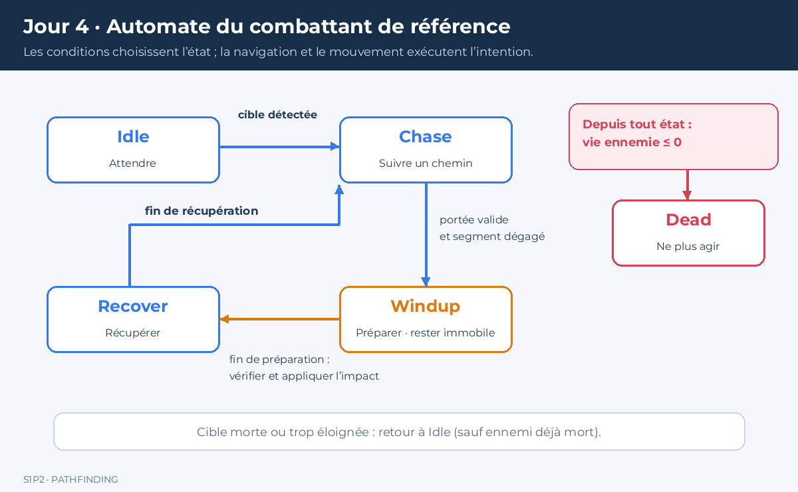
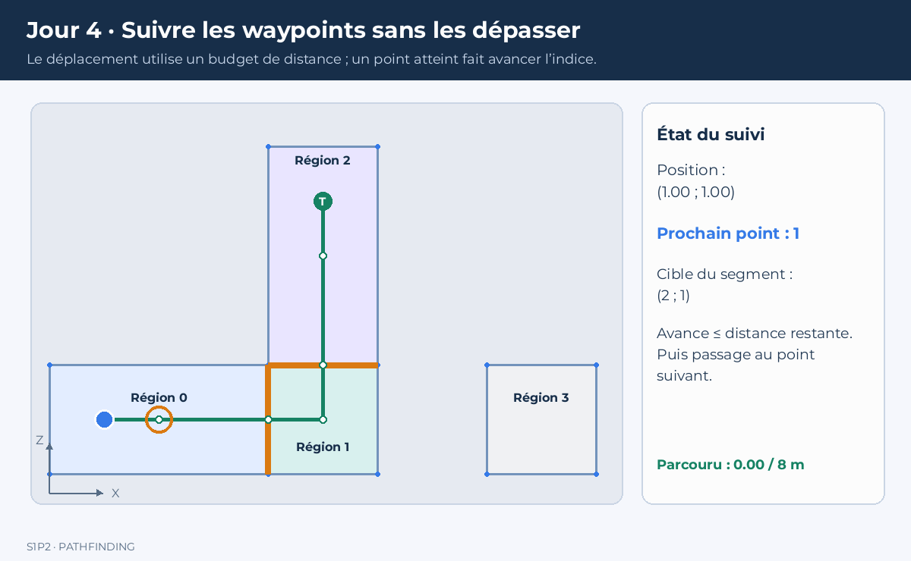

# Jour 4 — Atelier : programmer les comportements d’un ennemi


Aujourd’hui, vous développez vous-mêmes la poursuite, la préparation d’attaque, l’impact et la récupération. Le cours fournit les structures, les règles et des outils de validation. Les fonctions de comportement sont à écrire : aucune implémentation complète de l’automate n’est fournie dans le dossier étudiant.

Vous travaillez en console. Une IA doit déjà pouvoir être testée sans fenêtre graphique.

## 1. Préparer votre dossier et vos objectifs

Reprenez les fichiers validés du jour 3 : `Point`, `NavMesh`, `NavPath`, `MakeDemoMesh` et `FindNavPath`. La carte commune en L doit produire un coût de graphe de 6 et un trajet complet de longueur 8. Les parties du jour 3 ont été développées progressivement : terminez-les avant de chercher à déboguer un ennemi.

Dans l’archive, le dossier `Code/` contient :

| Fichier | Fourni ou à développer ? |
|---|---|
| `Agent.hpp` | Structures et déclarations fournies |
| `NavigationQueries.cpp` | Outil géométrique et noms d’états fournis |
| `Agent.cpp` | `Plan`, `Follow` et `Update` à implémenter |
| `main_tests.cpp` | Tests de référence fournis ; à compléter |

Les fonctions à développer lèvent une exception `A implementer` tant que vous ne les avez pas écrites. Ce message est un point de départ attendu, pas un succès de test. Remplacez chaque corps concerné par votre implémentation ; ne vous contentez pas de supprimer les exceptions.

**Si vous utilisez uniquement ce Markdown**, le contrat ci-dessous donne les déclarations. Le fichier géométrique fourni est disponible dans l’archive de l’atelier.

### Répartition du travail

À chaque étape, une personne prépare les cas et prédit les résultats ; l’autre programme. Inversez les rôles à l’étape suivante. Chaque membre doit pouvoir expliquer le code final.

Livrables : un automate annoté, les trois fonctions implémentées, des tests supplémentaires, une trace de simulation et un court bilan sur les limites.

## 2. Distinguer les responsabilités

**Perception :** quelles informations possède l’ennemi ? Ici : position et vie de la cible, distance et segment dégagé pour attaquer.

**Décision :** faut-il attendre, poursuivre, préparer une attaque, récupérer ou rester mort ?

**Navigation :** quand demander un chemin et que faire de son résultat ?

**Mouvement :** comment avancer sur le trajet avec un budget de déplacement ?

Dans ce laboratoire, l’ennemi connaît la position actuelle d’une cible proche, même si un détour est nécessaire. Cette perception est volontairement simplifiée. Une mémoire de dernière position vue sera une extension.

Avant le code, expliquez pourquoi appeler A* ne suffit pas à fabriquer une poursuite : il manque le suivi, les décisions de recalcul, l’arrêt et le traitement des échecs.

## 3. Écrire l’automate sur papier

Les noms d’états sont imposés pour conserver la compatibilité avec le jour 5. Les transitions sont à implémenter.

| État | Action attendue | Condition de sortie |
|---|---|---|
| `Idle` | Rester immobile | Cible vivante à distance ≤ `detectRange` : `Chase` |
| `Chase` | Planifier et suivre un trajet | Cible à portée et segment dégagé : `Windup` |
| `Windup` | Rester immobile, décompter la préparation | Fin du délai : impact éventuel, puis `Recover` |
| `Recover` | Rester immobile, décompter la récupération | Fin du délai : `Chase` |
| `Dead` | Ne plus agir | Aucune : état terminal |



*Ce schéma décrit le comportement à programmer. Il ne fournit pas son implémentation. Les durées indiquées sont des paramètres de simulation, pas des durées de cours.*

### Règles prioritaires

- Un ennemi ayant `hp <= 0` devient `Dead`, efface son trajet et ne frappe pas.
- `Dead` est terminal, même si une autre condition est vraie.
- Pour un ennemi vivant, une cible morte ou à distance strictement supérieure à `loseRange` provoque le retour à `Idle`, l’effacement du trajet et la remise à zéro du timer.
- La détection n’exige pas ici un segment direct dégagé ; l’attaque l’exige.

Tracez trois scénarios avant de programmer : cible immobile ; cible quittant la portée pendant la préparation ; ennemi tué juste avant l’impact. Notez état, timer et points de vie après chaque événement.

**Point de contrôle :** faites relire les priorités par votre binôme. Si la mort est traitée après les dégâts, votre ennemi pourrait encore frapper alors qu’il devrait être mort.

## 4. Lire le contrat des structures

Voici les membres utiles de `Agent.hpp`. Dans l’archive, ce fichier est déjà fourni : ne le créez pas en double.

```cpp
struct NavAgent {
    Point position;
    double speed=2.0;
    NavPath path;
    std::size_t next=0;
    double requestCooldown=0.0;
    Point lastGoal;
    bool hasGoal=false;
    int requests=0;
    bool useAStar=true;

    void Tick(double dt);
    void Clear();
    bool Finished() const;
    void Plan(const NavMesh& mesh, Point goal);
    void Follow(double dt);
};

enum class EnemyState { Idle, Chase, Windup, Recover, Dead };
struct Target { Point position; int hp=100; };
struct Enemy {
    NavAgent nav;
    EnemyState state=EnemyState::Idle;
    int hp=30;
    int damage=10;
    double detectRange=8.0, loseRange=10.0, attackRange=0.65;
    double windupDuration=0.5, recoverDuration=0.8;
    double timer=0.0;

    void Update(const NavMesh& mesh, Target& target, double dt);
};
```

`next` est l’indice du prochain point à atteindre. `requests` compte les appels réellement effectués à `FindNavPath`, pas le nombre de frames. `timer` mesure la préparation ou la récupération selon l’état actuel.

Les utilitaires `Tick`, `Clear` et `Finished` sont fournis. `Tick` réduit le délai de requête sans le rendre négatif. `Clear` efface le trajet et la destination mémorisée, mais conserve le compteur et le délai courant. `Finished` vérifie si l’indice suivant est au-delà du tableau.

Les déclarations restent dans `Agent.hpp`, les corps dans `Agent.cpp`. Ne faites jamais `#include "Agent.cpp"`.

## 5. Programmer le mouvement : `NavAgent::Follow`

Commencez par le mouvement indépendamment de toute décision ennemie. Préparez un `NavAgent`, affectez-lui le résultat de `FindNavPath`, puis choisissez le premier point suivant sa position initiale.

Votre fonction doit :

1. Ne rien faire si le chemin n’est pas `Found`, si `dt <= 0` ou si la vitesse est nulle ou négative.
2. Calculer le budget de distance `speed × dt`.
3. Examiner le waypoint d’indice `next` tant qu’il reste du budget et des points.
4. Ignorer un point déjà atteint sans normaliser un vecteur nul.
5. Si le waypoint est atteignable, y placer exactement l’agent, déduire la distance du budget et avancer `next`.
6. Sinon, avancer dans sa direction avec le budget restant, puis arrêter la boucle.



*La cadence de l’animation est illustrative. Le cercle orange montre le prochain waypoint. [Version fixe](illustrations/j4_suivi_resultat.png).*

### Tests à préparer

Sur le L, depuis (1,1), à vitesse 2 : après `Follow(1.0)`, la position attendue est (3,1). Un grand pas suivant doit atteindre exactement (5,5), sans dépasser. Testez aussi un trajet vide, un point répété et `dt=0`.

<details>
<summary>Indice 1 — Direction</summary>

Calculez `delta = waypoint - position`, puis `distance = Length(delta)`. Si la distance est presque nulle, passez au point suivant. Sinon, le déplacement de longueur budget est `delta * (budget / distance)`.

</details>

<details>
<summary>Indice 2 — Plusieurs points dans la même frame</summary>

Un simple `if` ne suffit pas : une boucle doit pouvoir consommer plusieurs segments. Décrémentez le budget après avoir atteint un waypoint. Ne le réinitialisez pas à chaque itération.

</details>

## 6. Programmer les requêtes : `NavAgent::Plan`

Une cible mobile ne doit pas provoquer une recherche à chaque frame. Implémentez cette politique de référence :

- Si le délai courant est positif, aucune requête.
- Sinon, rechercher seulement si aucune destination n’est mémorisée, si la cible a bougé de plus de 0,75, si la dernière recherche n’a pas trouvé de chemin, ou si le trajet est terminé alors que la cible reste à plus de 0,1.
- Appeler `FindNavPath` avec la position actuelle, le but et `useAStar`.
- Mémoriser le résultat, la destination, l’indice du prochain waypoint et `hasGoal`.
- Fixer un délai de 0,3 seconde et incrémenter `requests` une seule fois par recherche, même si elle échoue.

Si le trajet contient plusieurs points, commencez au point 1 car le point 0 correspond au départ. Sinon, placez `next` à la fin du tableau. Un échec ne doit pas laisser l’agent suivre un ancien trajet comme si la nouvelle requête avait réussi.

### Tests à préparer

Appelez plusieurs fois `Plan` sans laisser passer le délai : le compteur doit rester à 1. Après expiration, une cible inchangée avec un trajet encore actif ne doit pas provoquer une requête inutile. Une cible déplacée suffisamment doit provoquer un recalcul lorsque le délai le permet. Une destination extérieure doit donner `OutsideNavMesh`, sans déplacement.

<details>
<summary>Indice — Délai et nécessité sont deux conditions différentes</summary>

Un délai expiré autorise une recherche ; il ne la rend pas obligatoire. Construisez des booléens décrivant les motifs de recalcul, puis décidez s’il existe au moins un motif.

</details>

**Limite à observer :** les chemins du jour 3 repassent par le centre de la région initiale. Des recalculs fréquents peuvent provoquer des retours en arrière. Décrivez ce phénomène si vous l’observez. L’amélioration géométrique sera un travail distinct ; ne contournez pas le problème en déplaçant directement l’agent à travers les murs.

## 7. Programmer la poursuite : `Enemy::Update`

Développez d’abord les priorités puis `Idle` et `Chase`. L’attaque sera ajoutée à l’étape suivante.

Au début de chaque mise à jour valide, faites avancer le délai de navigation une seule fois. Le contrat des tests est : `dt` fini, positif ou nul, positions ennemies initiales sur le NavMesh.

Dans `Idle`, détectez la cible avec `detectRange`. Dans `Chase`, si les conditions d’attaque ne sont pas réunies, utilisez `Plan` puis `Follow`. Ne dupliquez pas le code de navigation dans l’automate.

La fonction fournie `SegmentInside(mesh,a,b)` indique si le segment est contenu dans l’union des régions. Elle sert de convention de visibilité pour ce laboratoire. Son calcul par clipping est un outil géométrique fourni ; vous n’avez pas à l’implémenter aujourd’hui.

**Limite :** une surface préparée pour le centre n’est pas une représentation générale des obstacles visuels. Dans le projet, une attaque devra être vérifiée contre les murs physiques.

### Validation de la poursuite

Simulez le L avec un pas fixe de `1.0/60.0`, ennemi en (1,1), cible en (5,5). Vérifiez à chaque mise à jour que l’ennemi reste localisable. Affichez uniquement les changements d’état et les nouvelles requêtes pour obtenir une trace lisible.

Ne commencez pas par dix ennemis : validez d’abord un agent.

## 8. Programmer l’attaque : `Windup` et `Recover`

Quand la cible est à distance ≤ `attackRange` et que `SegmentInside` accepte le segment, passez de `Chase` à `Windup` et initialisez le timer avec `windupDuration`.

Pendant `Windup`, le combattant de base reste immobile. Décrémentez le timer. À son expiration :

1. Revérifiez la portée et le segment avec la position actuelle de la cible.
2. Appliquez éventuellement `damage`, sans descendre sous zéro point de vie.
3. Passez à `Recover` et initialisez le timer avec `recoverDuration`, même si l’attaque a raté.

Pendant `Recover`, restez immobile puis revenez à `Chase` à l’expiration du délai.

**Un impact est un événement unique.** Soustraire des dégâts à chaque frame de `Windup` rendrait les dégâts dépendants de la fréquence de mise à jour.

### Scénarios obligatoires

| Scénario | Résultat attendu |
|---|---|
| Cible à portée pendant toute la préparation | Un impact, puis récupération |
| Cible quittant la portée avant l’impact | Aucun dégât, puis récupération |
| Cible proche mais segment bloqué | Pas d’attaque à travers la zone non navigable |
| Ennemi tué avant l’impact | `Dead`, aucun dégât |
| Cible déjà morte | Ennemi vivant en `Idle` |
| Cible au-delà de `loseRange` | Abandon et trajet effacé |

<details>
<summary>Indice — Éviter les dégâts répétés</summary>

L’événement d’impact appartient à la sortie de `Windup`. Une fois traité, changez immédiatement d’état. Ne laissez pas un timer expiré dans le même état d’attaque.

</details>

Pour le socle, une mise à jour traite l’état courant sans consommer récursivement tout le temps restant dans les états suivants. Une transition peut donc décaler un événement d’une frame. Les tests utilisent un petit pas fixe ; ne promettez pas une précision temporelle parfaite pour des pas arbitrairement grands.

## 9. Lancer les tests et ajouter vos propres cas

Le fichier `main_tests.cpp` vérifie la géométrie fournie, la poursuite, l’unicité de l’impact, l’esquive, la cible extérieure, la mort et le suivi sans dépassement. Il doit afficher `Tests Jour 4 OK` seulement lorsque votre implémentation est fonctionnelle.

Ajoutez au moins trois tests : refus d’une attaque bloquée malgré une courte distance, abandon au-delà de la limite, absence de requêtes répétées pour une cible inchangée. Un cas bloqué possible est un ennemi en (3.9,1.9), une cible en (4.1,2.5) : leur distance est inférieure à 0,65, mais le segment coupe le coin extérieur du L.

Le seuil `requests < 20` sur dix secondes de poursuite d’une cible fixe est un contrôle grossier, pas un budget universel pour un jeu complet. Analysez aussi pourquoi les recherches ont été déclenchées.

### Visual Studio

Ajoutez `Agent.cpp`, `NavigationQueries.cpp` et `main_tests.cpp` à votre projet existant. Conservez les sources du jour 3, mais excluez son ancien `main.cpp` de la génération : il ne doit exister qu’un seul `main`.

Activez C++17 et utilisez Debug pour les tests. Dans un terminal de développement Visual Studio, si la navigation du jour 3 est définie dans `NavMesh.cpp` :

```bat
cl /nologo /std:c++17 /EHsc /W4 /UNDEBUG main_tests.cpp Agent.cpp NavigationQueries.cpp NavMesh.cpp /Fe:jour4.exe
jour4.exe
```

Si toutes les fonctions du jour 3 sont encore `inline` dans les en-têtes, retirez `NavMesh.cpp` de cette commande. Ne mélangez pas les deux organisations. Les quatre fichiers fournis pour les agents sont à placer à côté de vos fichiers de navigation, ou ajoutez leur dossier aux chemins d’inclusion.

## 10. Concevoir une variation de comportement

Une fois le socle validé, choisissez une variation : préparation annulable ; retour à un poste de garde ; mémoire de dernière position vue. Avant de coder, fournissez un tableau « déclencheur / décision / action / test » et expliquez la différence avec le premier ennemi.

Une variation uniquement de couleur, de vitesse ou de points de vie ne constitue pas une nouvelle décision. Gardez les tests du premier combattant : introduisez un paramètre ou un type distinct pour ne pas modifier silencieusement son contrat.

Vous n’avez pas à construire aujourd’hui les deux archétypes complets du projet. L’objectif est de savoir concevoir, développer et tester un automate ; son intégration au combat et aux niveaux personnels restera à réaliser.

## 11. Analyser le comportement collectif et la notion d’IA

Comparez 1, 3 puis 10 agents dans la même carte. Comptez les requêtes, observez les superpositions et rejouez les scénarios. Sans séparation locale, des ennemis peuvent occuper la même position ; un pathfinding correct ne résout pas les collisions entre agents.

Rédigez un court bilan : hypothèse, observation, explication probable et limite. Un groupe suivant les mêmes portails n’est pas nécessairement en train de coopérer. Distinguez ce que vous mesurez de ce que vous supposez.

Notre automate est une IA gameplay fondée sur des règles explicites, sans entraînement. A* cherche un chemin dans une représentation. Une IA générative produit du contenu, comme du texte ou une image. Un jeu peut combiner ces approches, mais aucun modèle génératif n’est nécessaire à nos décisions de poursuite et d’attaque.

## 12. Vérification finale

Chaque membre doit expliquer : l’ordre des priorités, la consommation du budget de déplacement, les motifs de recalcul, le moment exact des dégâts et les conditions d’échec d’une attaque.

À conserver : les sources implémentées, les tests ajoutés, l’automate et le bilan. Faites un commit `jour-4-agents`.
